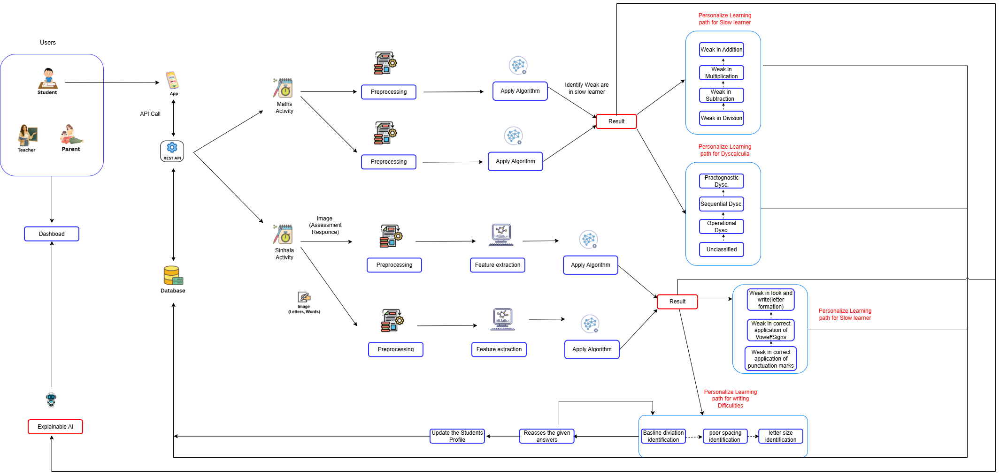

# KND_CDAP_IT_03

# AI-Based Personalized Sinhala Language Learning System for Children with Learning Disabilities 🙋‍♀️📚🧠

## 👥 Team Members

| Role | Name | Student ID |
|---|---|---|
| Member 1 | P.J.S.G. Dissanayaka | IT23191310 |
| Member 2 | D.P.W.A.S.T. Abeysinghe | IT23309692 |
| Member 3 | T. Gunasekara | IT23287990 |
| Member 4 | T.M.R.T. Thennakoon | IT23404878 |

### Academic Supervision

- **Supervisor:** Ms. Dinusha Premasiri
- **Co-supervisor:** Ms. Chathurika Koswaththe
- **External Supervisor:** Gayani Champika — Principal, Teddy’s Castle Special Needs School

## 🌟 Overview

The **AI-Based Personalized Sinhala Language Learning System for Children with Learning Disabilities** is an AI-driven mobile learning platform designed to support children who experience difficulties in Sinhala literacy and early mathematics.

The system combines AI-based screening, personalized learning interventions, and progress tracking. It aims to identify each child's specific learning difficulties and provide suitable activities rather than assigning only a general learning category.

The platform focuses on slow learning in mathematics, dyscalculia, slow learning in Sinhala language, and Sinhala learning difficulties.

## 🎯 Main Objectives

To design and develop an integrated, AI-driven assistive mobile platform that combines multi-modal screening, personalized intervention, and intelligent progress tracking across Sinhala literacy and early mathematics.

The main objectives are to:

- Identify children's specific learning difficulties through assessment activities.
- Detect individual weak areas in Sinhala literacy and mathematics.
- Provide explainable assessment results for teachers and parents.
- Deliver personalized learning activities based on identified difficulties.
- Track children's learning progress over time.

## ⚠️ Problem Statement

Children with learning difficulties may not receive timely and individualized support in conventional classroom environments. Existing approaches often classify learners broadly or assess performance using limited indicators without identifying the specific skills in which a child needs support.

Furthermore, identification and intervention are often handled separately, and children may receive similar activities despite having different learning needs. This makes it difficult for teachers and parents to understand the reasons behind a child's learning difficulties and provide appropriate support.

## 🎯 Purpose

The purpose of this system is to support the early identification of learning difficulties and provide children with suitable, personalized learning pathways.

By combining AI-based assessment with explainable results and targeted interventions, the platform aims to help teachers and parents understand each child's learning needs and support improvement in Sinhala literacy and early mathematics.

## 📈 System Overview

  

The system collects assessment responses and activity data through the mobile application. The collected data is preprocessed, and relevant features are extracted before machine-learning or deep-learning models are applied to identify learning difficulties.

Based on the assessment results, the system identifies specific weak areas and connects them to personalized learning pathways. Explainable AI is used to provide understandable reasons behind relevant assessment results, supporting teachers and parents in understanding the child's learning needs.

## 🧩 Individual Components

### 1. Explainable AI-Based Knowledge Gap Detection and Personalized Mathematics Learning System for Slow Learners

**Member:** P.J.S.G. Dissanayaka — IT23191310

This component identifies specific mathematics knowledge gaps among slow learners and provides personalized learning activities based on the Grade 3 syllabus.

**Main functionalities:**

- Identify mathematical weaknesses using assessment and interaction data.
- Assess addition, subtraction, multiplication, and division skills.
- Analyse activity information such as correctness and response time.
- Apply machine-learning algorithms to identify weak areas.
- Use Explainable AI to communicate reasons behind predictions.
- Provide personalized mathematics learning activities.

### 2. Explainable AI-Based Dyscalculia Screening and Adaptive Personalized Mathematics Intervention

**Member:** D.P.W.A.S.T. Abeysinghe — IT23309692

This component focuses on screening children aged 8–9 for dyscalculia risk and identifying specific mathematical difficulty profiles.

**Main functionalities:**

- Screen children for dyscalculia risk using mathematical performance and interaction data.
- Analyse features such as correctness, response time, hints, retries, and completion time.
- Identify Practognostic, Sequential, Operational, and mixed difficulty profiles.
- Use Explainable AI to explain screening results.
- Provide personalized mathematics intervention pathways based on identified difficulties.

### 3. Explainable AI-Based Sinhala Handwriting Assessment and Personalized Intervention System

**Member:** T. Gunasekara — IT23287990

This component analyses Sinhala handwriting at word level to identify specific handwriting difficulties and provide targeted support.

**Main handwriting difficulty areas:**

- Letter-size consistency
- Baseline deviation
- Spacing consistency

**Main functionalities:**

- Accept handwriting images from the mobile application.
- Preprocess handwriting images and extract relevant features.
- Identify baseline deviation and word-spacing difficulties.
- Provide Sinhala feedback based on assessment results.
- Provide personalized handwriting practice activities.
- Reassess completed activities and update the learner's difficulty profile.

### 4. Explainable AI-Based Early Identification of Children Who Are Slow in Learning Sinhala, with Personalized Sinhala Learning Pathways

**Member:** T.M.R.T. Thennakoon — IT23404878

This component identifies specific Sinhala language micro-skills in which a child is progressing slowly and provides personalized learning pathways.

**Main assessment areas:**

- Look and Write (Sinhala letter formation)
- Correct application of vowel symbols
- Correct application of punctuation marks

**Main functionalities:**

- Collect assessment responses.
- Preprocess data and apply deep-learning models.
- Identify specific weak Sinhala micro-skills, including combinations of difficulties.
- Provide Grade 3 syllabus-based intervention activities.
- Use Explainable AI to explain assessment results.
- Support personalized Sinhala learning pathways and progress reporting.

## 🛠️ Used Technologies

### Artificial Intelligence and Machine Learning

- Decision Tree
- Logistic Regression
- Naive Bayes
- K-Nearest Neighbors (KNN)
- Support Vector Machine (SVM)
- Random Forest
- XGBoost
- Explainable AI (XAI)
- SHAP

### Deep Learning

- Convolutional Neural Networks (CNN)
- ResNet50
- DenseNet121
- EfficientNetB0
- MobileNetV2

### Image Processing

- OpenCV
- OpenCV-based feature extraction
- OpenCV + Support Vector Machine (SVM) — Sinhala word-spacing classification
- OpenCV + Random Forest — Sinhala handwriting baseline-deviation classification
- Image preprocessing
- Handwriting measurement and analysis
  
### Backend

- Python FastAPI

### Application Platform

- React Native Mobile Application
